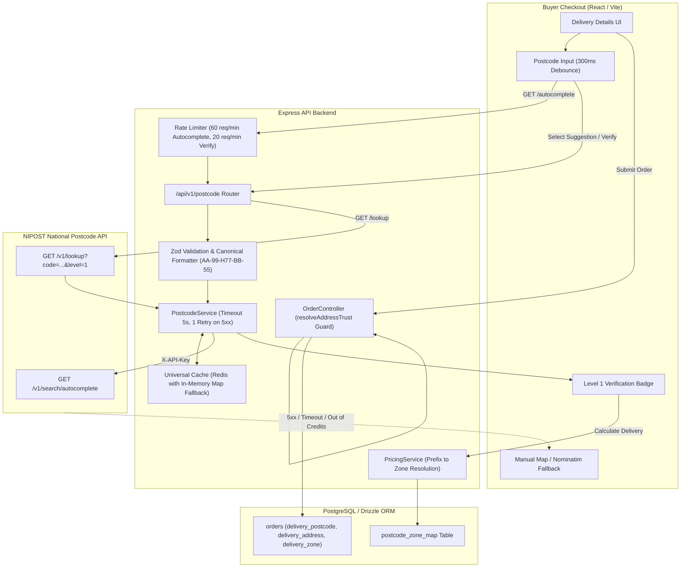

# Nigeria National Digital Postcode (NIPOST) Integration

This document details the architecture, configuration, API endpoints, failure matrix, and live demo guide for Nigeria's National Digital Alphanumeric Postcode system integrated into FlowMart's Buyer Checkout flow.

---

## 1. System Architecture & Flow



---

## 2. Environment Variables

### Backend Configuration (`backend/.env`)
| Variable | Required | Default | Description |
| :--- | :---: | :--- | :--- |
| `POSTCODE_API_KEY` | **Yes** | `""` | NIPOST API key (e.g. `nipost_test_...`). Transmitted in header `X-API-Key`. |
| `POSTCODE_BASE_URL` | No | `https://api.postcode.gov.ng` | Upstream NIPOST API base URL. |
| `REDIS_URL` | No | `""` | Redis connection string. If omitted, falls back to an in-memory TTL Map. |
| `GOOGLE_CLIENT_ID` | **Yes** | `""` | Google OAuth 2.0 Web Client ID. |
| `GOOGLE_CLIENT_SECRET` | **Yes** | `""` | Google OAuth 2.0 Client Secret. |

### Frontend Configuration (`frontend/.env`)
| Variable | Required | Default | Description |
| :--- | :---: | :--- | :--- |
| `VITE_API_URL` | **Yes** | `http://localhost:5000/api/v1` | Base URL for FlowMart API backend. |
| `VITE_GOOGLE_CLIENT_ID` | **Yes** | `""` | Google OAuth 2.0 Client ID for Frontend Google Sign-In. |

---

## 3. Database Schema & Migration

### Migrations
Custom Drizzle migration `0004_add_postcode_and_zone_mapping.sql`:
- Added `delivery_address` (`TEXT`), `delivery_postcode` (`VARCHAR(20)`), and `address_source` (`VARCHAR(20)`) to `orders`.
- Added `postcode` (`VARCHAR(20)`) to `addresses`.
- Created `postcode_zone_map` table with index on `prefix` (`AA-99`) mapping to delivery pricing zones.

### Seeding Zone Mappings
To seed default prefix mappings (Lagos, Abuja, Ekiti) into the database:
```bash
cd backend
npm run seed:zones
```

---

## 4. API Endpoints & `curl` Examples

### A. Autocomplete Postcode
```bash
curl -X GET "http://localhost:5000/api/v1/postcode/autocomplete?q=LA-11" \
  -H "Authorization: Bearer <YOUR_ACCESS_TOKEN>"
```
**Response (200 OK):**
```json
{
  "success": true,
  "data": {
    "query": "LA-11",
    "suggestions": [
      {
        "code": "LA-11-201",
        "state": "Lagos",
        "lga": "Ikeja",
        "description": "Ikeja Central Business District"
      }
    ]
  }
}
```

### B. Verify Postcode (Level 1)
```bash
curl -X GET "http://localhost:5000/api/v1/postcode/verify?code=LA-11-H77-BB-55" \
  -H "Authorization: Bearer <YOUR_ACCESS_TOKEN>"
```
**Response (200 OK):**
```json
{
  "success": true,
  "data": {
    "postcode": "LA-11-H77-BB-55",
    "valid": true,
    "source": "nipost_level_1"
  }
}
```

### C. Calculate Delivery with Postcode
```bash
curl -X POST "http://localhost:5000/api/v1/orders/calculate-delivery" \
  -H "Authorization: Bearer <YOUR_ACCESS_TOKEN>" \
  -H "Content-Type: application/json" \
  -d '{
    "postcode": "LA-11-H77-BB-55",
    "distanceKm": 5
  }'
```
**Response (200 OK):**
```json
{
  "success": true,
  "deliveryCalc": {
    "finalDeliveryFee": 1500,
    "resolvedZone": "Lagos Central",
    "distanceKm": 5
  }
}
```

### D. Place Order with Verified Postcode
```bash
curl -X POST "http://localhost:5000/api/v1/orders" \
  -H "Authorization: Bearer <YOUR_ACCESS_TOKEN>" \
  -H "Content-Type: application/json" \
  -d '{
    "items": [{ "productId": "prod-123", "quantity": 1 }],
    "payment_method": "card",
    "deliveryPostcode": "LA-11-H77-BB-55",
    "deliveryAddress": "Suite 402, Ikeja Plaza, LA-11-H77-BB-55",
    "phone": "+2348012345678"
  }'
```

---

## 5. Failure & Resilience Matrix

| Scenario | HTTP Code | Internal Code | System Behavior | User Experience |
| :--- | :---: | :--- | :--- | :--- |
| **Typo / Look-alike character** (e.g. `O` instead of `0`, or `S` instead of `5`) | `400` | `INVALID_FORMAT` | Regex look-alike detection normalizes common ambiguities. | Amber banner: *"Did you mean `LA-11-H77-BB-55`? (Click to apply)"*. |
| **Unregistered Postcode** | `404` | `POSTCODE_NOT_FOUND` | Cached for 2 minutes to prevent repeated upstream queries. | *"Postcode not found in national registry. Please check or use map."* |
| **Upstream 429 Rate Limit** | `429` | `UPSTREAM_RATE_LIMIT` | Inspects `Retry-After` header, throttles subsequent calls. | Smooth backoff. |
| **Upstream 5xx / Timeout (5s)** | `503` | `UPSTREAM_SERVER_ERROR` | Retries once after 500ms backoff. If still failing, triggers silent trust fallback. | Non-blocking alert: *"Postcode service temporarily unreachable. Click to switch to manual map entry."* |
| **Missing API Key / Credits Exhausted** | `503` | `UPSTREAM_AUTH_ERROR` | Logged as auth error, activates `resolveAddressTrust` silent fallback. | User continues with standard address entry without checkout friction. |

---

## 6. How to Run the Automated Test Suite

All unit and integration tests are strictly isolated and mock external network calls:
```bash
cd backend
npm run test -- --testPathPatterns=postcode
```

**Test Coverage Summary:**
- **`postcode.util.test.ts`**: 42 table-driven tests (format normalization, look-alike corrections, prefix extraction, partial code validation).
- **`postcode.service.test.ts`**: 12 tests (Level 1 lookup, caching, timeout handling, 5xx retries, address trust fallback).
- **`postcode.routes.test.ts`**: 10 tests (JWT authentication, rate limiting, Zod schema validation, error payloads).
- **Total: 64 passed / 64 total.**
